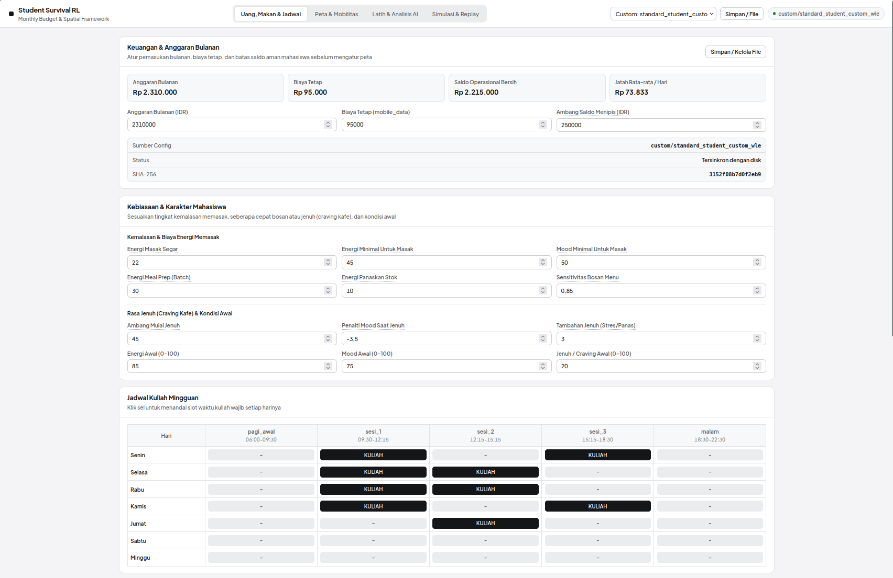
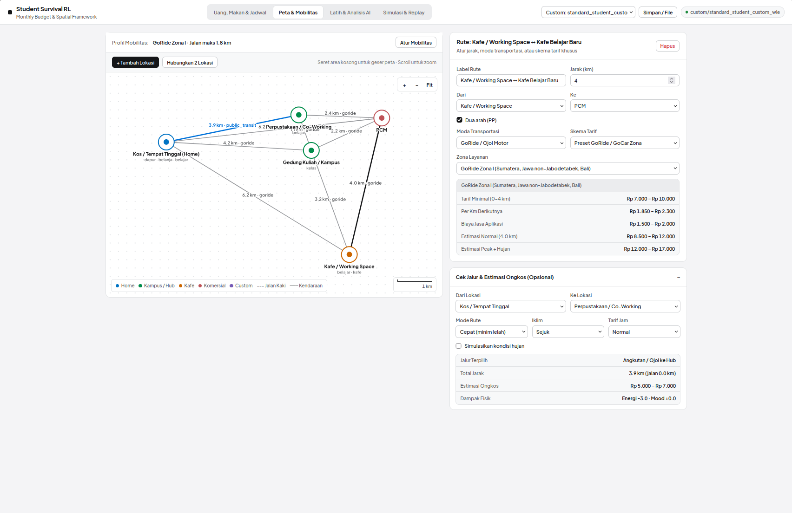
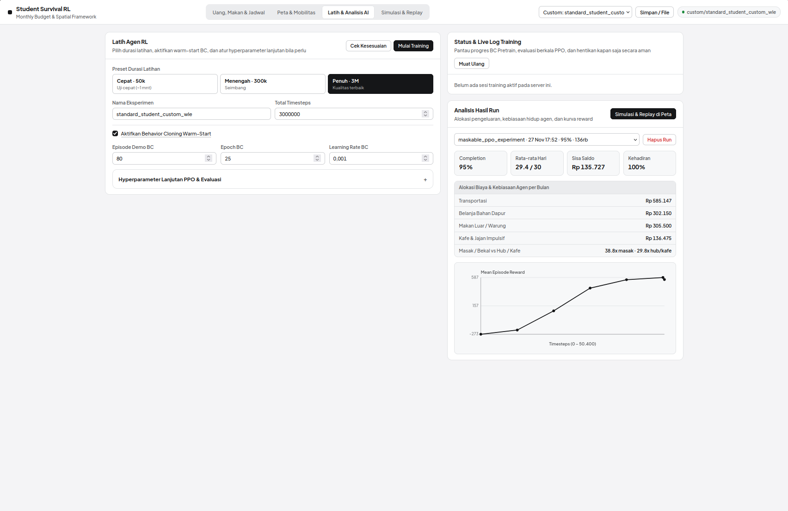
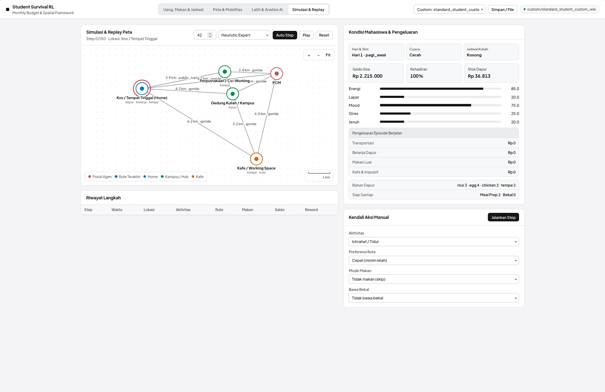
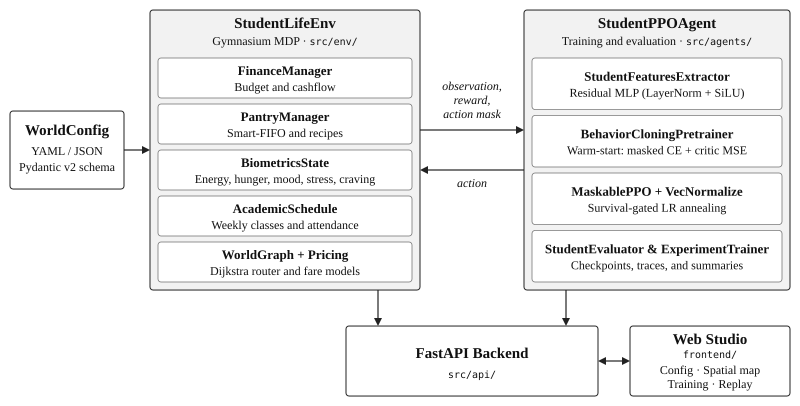

# Student Monthly Spending RL

A configurable Reinforcement Learning (`MaskablePPO` + Behavior Cloning warm-start) framework, FastAPI backend, and interactive web studio for modeling 30-day student monthly spending, meal and pantry management, academic schedules, biometric/psychological dynamics, and spatial commuting trade-offs.

---

## Demo

### 1. Monthly Budget, Lifestyle Habits, Class Schedule & Pantry
Configure monthly allowances, fixed expenses, cooking laziness/energy thresholds, cafe craving dynamics, weekly class schedules, external food catalogs, and custom kitchen ingredients (such as coffee, instant noodles, or staples).



### 2. Spatial Graph & Mobility Studio
Infinite pan-and-zoom graph editor for locations and transport routes with automatic map-to-distance updates, walking preferences/limits, and distance-based fare models (GoRide Zona I–III, GoCar, custom per-km, fixed transit ranges, and free walking).



### 3. RL Training, Live Logs & Run Analysis
Launch `Behavior Cloning` + `MaskablePPO` experiments directly from the browser with preset durations, live epoch/evaluation log streaming, safe stop checkpoints, monthly spending breakdowns, and evaluation reward curves.



### 4. Interactive Simulation & Trained Policy Replay
Inspect step-by-step decisions on the spatial map using either manual masked controls, the heuristic baseline, or any saved RL checkpoint (`best` / `final`) with live biometrics, pantry stock, and category spending logs.



---

## Core Capabilities

- **Monthly Budget & Cashflow Simulation**: Tracks operational balance, fixed monthly expenses, burn rate, budget runway, low-balance alerts, and spending by category (`transport`, `grocery`, `external_food`, `cafe`, `minimarket_impulse`).
- **Dynamic Smart-FIFO Pantry & Custom Ingredients**: Supports raw ingredients, batch meal-prep, packed lunch (*bekal*), per-batch shelf-life aging/spoilage, meal-boredom window penalties, and user-defined custom kitchen ingredients beyond the 4 standard staples.
- **Declarative Spatial World Graph**: Locations and routes are defined in a Pydantic-validated `WorldConfig` (`schema_version: "2.0"`). Every node declares capabilities (`can_sleep`, `has_kitchen`, `has_grocery`, `is_class_venue`, `can_study`, `closes_at_night`), ambient mood/stress/craving rates, study profiles, and local food menus.
- **Dijkstra Multi-Objective Routing & Transport Pricing**: Computes optimal `"fastest"` (minimum physical fatigue/effort) and `"cheapest"` (minimum fare) paths respecting user walking preferences (`prefer_walk`, `balanced`, `avoid_walk`), rain conditions, and 4 pricing models (`free`, `manual_range`, `per_km_custom`, `ride_hailing_zone`).
- **End-to-End Web Studio**: Zero-build ES-module frontend served directly by FastAPI with local YAML persistence (`configs/custom/*.yaml`), YAML import/export, background training jobs with live logs and safe cancellation, and interactive replay.

---

## Architecture

### System Overview



### MDP Formulation (`src/env/`)

| Component | Design |
| --- | --- |
| **Episode Horizon** | 30 days × 5 daily time slots (`pagi_awal`, `sesi_1`, `sesi_2`, `sesi_3`, `malam`) = 150 steps/episode. |
| **Observation Space** | Continuous `Box` vector dynamically sized to the active graph, food catalog, and custom pantry ingredients: cyclical day/time encodings, weather/rain/peak-tariff flags, class schedule context, location one-hot & node flags, balance/inventory/runway metrics, 5 biometric meters (`energy`, `hunger`, `mood`, `academic_stress`, `cafe_craving`), ingredient stocks, minimum FIFO shelf lives, and recent-meal boredom flags. |
| **Action Space** | 6-head `MultiDiscrete` (`activity`, `route`, `meal_mode`, `cook_combo`, `bring_bekal`, `grocery_bundle`) with dimensions automatically derived from configured activities and pantry ingredients. |
| **Action Masking** | Exact per-step boolean mask (`build_action_masks`) preventing invalid actions (unscheduled classes, unaffordable routes/foods/bundles, curfew violations, missing kitchen/ingredients, or insufficient energy/mood gates). |
| **Reward Function** | Combines per-step survival reward, continuous wellbeing weights (energy, mood, hunger, stress, excess craving), class attendance bonus, critical-state and food-spoilage penalties, terminal 30-day completion + remaining savings reward, and Potential-Based Budget Shaping ($\gamma \Phi(s') - \Phi(s)$). |

### Policy Network & Two-Stage Training (`src/agents/`)

1. **Feature Extractor (`StudentFeaturesExtractor` in `src/agents/networks.py`)**:
   - Input projection: `Linear(obs_dim, hidden_dim) -> LayerNorm -> SiLU`
   - Residual block: `Linear -> LayerNorm -> SiLU -> Linear -> LayerNorm` with skip connection and `SiLU` activation
   - Decoupled Actor (`pi`) and Critic (`vf`) MLP heads (default `[128, 128]`, `SiLU`, orthogonal initialization) wrapped inside `sb3_contrib.MaskablePPO` with `VecNormalize`.
2. **Stage 1 — Behavior Cloning Warm-Start (`src/agents/pretrain.py`)**:
   - Collects demonstrations using a graph-agnostic heuristic policy (`default_balanced_expert_policy`), warms up `VecNormalize` observation/return statistics, and optimizes masked Actor Cross-Entropy + entropy bonus alongside Critic MSE loss.
3. **Stage 2 — MaskablePPO Fine-Tuning (`src/agents/trainer.py`)**:
   - Uses survival-gated learning rate scheduling: learning rate remains constant while the agent learns to achieve 100% 30-day survival, then anneals smoothly toward 10% of the base learning rate during budget/wellbeing optimization.
   - Evaluates deterministically at regular intervals (`PeriodicEvalCallback`), persists `best_model.zip` / `final_model.zip` with matching `VecNormalize` statistics and `env_config_snapshot.yaml`, and exports `eval_history.csv`, `final_eval_summary.json`, and `best_episode_trace.csv`.

---

## Project Structure

```text
.
├── configs/
│   ├── presets/
│   │   ├── standard_student.yaml   # Default 4-location balanced student template
│   │   ├── minimal_dorm.yaml       # Lightweight 2-location dorm/campus template
│   │   └── surabaya_its.yaml       # Multi-hub 4-location spatial transit template
│   └── custom/                     # Local user-saved configs (git-ignored)
├── docs/
│   ├── studentlife_architecture.svg # System architecture diagram
│   └── demo/                        # Application screenshots
├── frontend/                       # Zero-build ES-module web studio
│   ├── index.html
│   ├── css/
│   ├── partials/                   # Tab views (config, graph, training, simulation)
│   └── js/                         # Viewport canvas, API client & page controllers
├── src/
│   ├── env/                        # Gymnasium env, WorldConfig schema, WorldGraph, pricing, pantry, biometrics
│   ├── agents/                     # Residual network, BC pretrainer, MaskablePPO wrapper, trainer, evaluator
│   └── api/                        # Modular FastAPI app & routers
├── tests/
│   └── test_framework.py           # End-to-end schema, routing, pantry, RL & API tests
├── env_config.yaml                 # Active root environment template
└── pyproject.toml
```

---

## Quickstart

### 1. Environment Setup (Recommended: `uv`)

```bash
uv venv .venv
source .venv/bin/activate
uv pip install -e ".[dev]"
```

### 2. Launch the Web Studio & API Server

```bash
uvicorn src.api.app:app --reload --port 8000
```

Open `http://localhost:8000` in your browser to configure monthly budget/habits/pantry, edit the spatial graph, run training jobs with live logs, and replay trained agents.

### 3. Programmatic Python Usage

```python
from src.agents import StudentPPOAgent

agent = StudentPPOAgent(
    yaml_path="configs/presets/standard_student.yaml",
    num_environments=4,
    discount_factor_gamma=0.995,
    seed=42,
)

# Optional Behavior Cloning warm-start
agent.pretrain_bc(num_episodes=60, epochs=20)

# MaskablePPO training with periodic checkpointing
result = agent.train_with_logging(
    total_timesteps=300_000,
    eval_interval_steps=25_000,
    experiment_name="standard_student",
)
print(result["final_summary"])
```

### 4. Run Automated Tests

```bash
pytest -v tests/test_framework.py
```

---

## REST API Summary

| Method & Endpoint | Purpose |
| --- | --- |
| `GET /health`, `GET /schema` | Service health check, `WorldConfig` & `TrainingProfileConfig` JSON Schemas, and ride-hailing zone presets |
| `GET /presets`, `GET /configs` | List built-in templates, active root config, and local custom configs |
| `GET /configs/{scope}/{name}` | Load a YAML config with `sha256` and raw `yaml_text` |
| `POST /configs/save`, `POST /configs/render-yaml`, `POST /configs/import-yaml`, `DELETE /configs/custom/{name}` | Validate, save (with optimistic `sha256` check), render/export, import, or delete local custom configs |
| `POST /config/validate`, `POST /graph/preview-route` | Validate a `WorldConfig` and preview Dijkstra `"fastest"` / `"cheapest"` routes with fare & physical costs |
| `POST /training/validate`, `POST /training/start`, `GET /training/jobs`, `POST /training/jobs/{id}/stop` | Validate training profiles, run background BC + MaskablePPO jobs, stream live logs/progress, and stop safely |
| `GET /runs`, `GET /runs/{id}`, `GET /runs/{id}/trace`, `DELETE /runs/{id}` | Inspect saved experiment summaries, evaluation curves, episode traces, or delete old runs |
| `POST /sim/sessions`, `POST /sim/sessions/{id}/step`, `POST /sim/sessions/{id}/auto-step`, `POST /sim/sessions/{id}/reset`, `DELETE /sim/sessions/{id}` | Run interactive manual, heuristic, or trained-model step-by-step simulations |

---

## Privacy & Local Configuration

All user-saved configurations (`configs/custom/*.yaml`), trained checkpoints (`*.zip`, `*.pkl`), experiment outputs (`runs/`), and personal notebooks (`main.ipynb`) are excluded via `.gitignore` so personal budgets, routines, and local runs remain private on disk. The tracked YAML files in `configs/presets/` and `env_config.yaml` contain illustrative template values intended to be customized.
